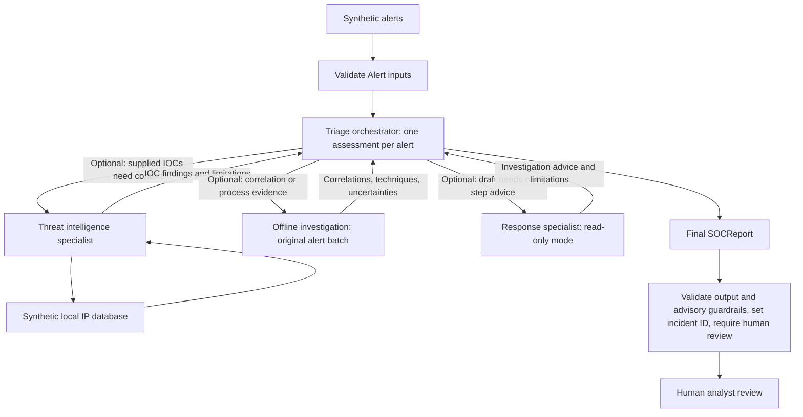

# SOC triage architecture

## HTTP boundary

`src/api.py:app` exposes `GET /health` and `POST /analyse`. The health route
checks process liveness without calling agents. Analysis validates an
`AnalyseRequest` (`alerts: list[Alert]`, nonempty with unique IDs), calls the
existing async `triage_alerts`, and returns an `AnalyseResponse`
(`reports: list[SOCReport]`). HTTP contracts live in `src/models/api.py`.

The API handles environment configuration, HTTP error translation, and a
60-second async workflow deadline. Agent selection, specialist tools, report
guardrails, incident IDs, and required human review remain in the workflow.
Invalid requests return 422 before model calls; failures return safe messages
with 502, 503, 504, or 500 according to their cause. No exception text is exposed.
The advisory route never invokes the separate containment workflow.
TestClient tests mock triage; agent tests independently verify workflow behavior.

## Agent workflow

Interview explanation: triage is the analyst in charge. It reads an alert, asks
specialists for help when useful, weighs their evidence, and writes the final
SOCReport. Specialists return to triage; they never take over the workflow.



`triage_alerts` retains its public interface: one Alert or a nonempty list in,
one SOCReport per alert out. `create_triage_agent` attaches three optional tools
and no handoffs. Tool selection is model-driven, guided by explicit usefulness
criteria rather than a mandatory pipeline. Simple alerts can skip every tool.
Investigation receives the original batch through a closure so the model cannot
replace it with invented telemetry. Only this helper sees batch context; each
triage model request starts with the current alert.

Threat intelligence uses `Agent.as_tool()` and returns validated IOC evidence.
Investigation wraps the existing deterministic offline helper as a function tool.
Response wraps `recommend_response` with a provisional report and read-only mode;
nonempty containment output is rejected. Its ResponsePlan is advice for triage,
not a replacement final SOCReport. Standalone response calls still support
approval-required proposals. A separate opt-in containment workflow provides
human-approved simulation; the advisory agents do not execute it.

Triage owns severity, summary, evidence, and recommendations. Specialist data is
untrusted evidence. Output is revalidated, incident IDs derive from alert IDs,
and human review is forced in Python. API, specialist, and validation failures
propagate; no fake report is substituted. No new dependencies are introduced.

All security inputs and reputation data are synthetic. Model requests are live,
but there are no external reputation lookups or real containment execution tools.
Structured validation checks shape and approval flags, not factual accuracy.
Mocked tests verify wiring, optional execution, evidence contracts, failures, and
human review; they cannot guarantee a live model's routing or assessment quality.

## Lightweight triage guardrails

- `Alert` rejects blank required text (`id`, `source`, `alert_type`, and
  `description`), missing fields, and malformed field types. Triage revalidates
  the entire batch before calling the SDK, including mutated or constructed
  model objects, and rejects duplicate IDs. This prevents unusable inputs from
  consuming model calls or producing ambiguous incident reports.
- `SOCReport` has a fixed `containment_status="not_performed"` and rejects
  undeclared fields such as `executed`. `src/guardrails.py` checks all generated
  prose for common containment terms and account/access blocking, disabling,
  or revocation language. Matches reject the report, including quoted or negated
  matches. This conservative rule prevents common misleading action claims;
  triage communicates its status through the fixed field instead of action prose.
- Final reports require nonblank `evidence` and `uncertainties` lists. Instructions
  reserve evidence for supplied observations and attributed source claims, and
  put hypotheses and missing context in uncertainties. A small wording check
  rejects common speculative terms in evidence. Confidence alone cannot replace
  a written limitation. This helps prevent guesses from appearing as observations.

These are ordinary Python/Pydantic checks, with no extra dependencies or model
calls. Failures propagate rather than silently rewriting output. `uncertainties`
defaults to an empty list for existing standalone report callers and provisional
drafts; the final triage boundary requires it to be populated. The word checks
are English heuristics, can reject legitimate source quotations, and cannot
recognize every paraphrase or establish factual grounding. Human review remains
required. Tests mock the SDK; no containment simulation runs during triage tests.

This follows the manager ownership pattern described in the
[official OpenAI orchestration documentation](https://developers.openai.com/api/docs/guides/agents/orchestration).

Verification from PowerShell at the repository root:

```powershell
.\.venv\Scripts\python.exe -m pytest
git diff --check
```

## Optional simulated containment review

`src/agents/containment_agent.py` exposes `run_host_isolation` separately from
triage. Its only tool is `src/tools/containment.py:request_host_isolation`, with
`needs_approval=True`. The SDK runner returns an interruption before invoking
the tool. The console reviewer displays the pending hostname, reason, and
simulation effect, then approves only an explicit `APPROVE`; all other responses
reject the call. The same `RunState` resumes after each decision. Approvals are
per call; additional requests pause again.

The tool only formats a SIMULATED message. It has no EDR client, network call,
or host-changing operation. Approval authorizes this message-only simulation.
Offline tests exercise the actual SDK pause/resume path with a fake model,
spy on tool invocation, and block network connections. This follows the
[official OpenAI human-review pattern](https://developers.openai.com/api/docs/guides/agents/guardrails-approvals).
